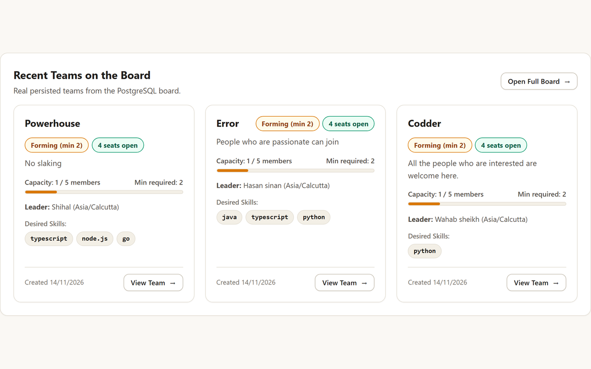
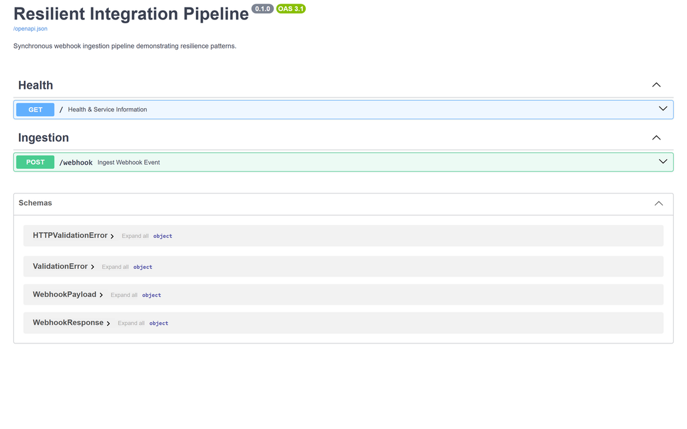
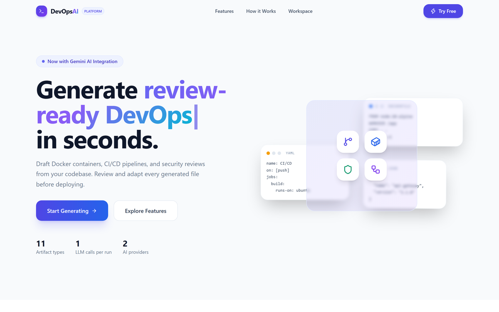
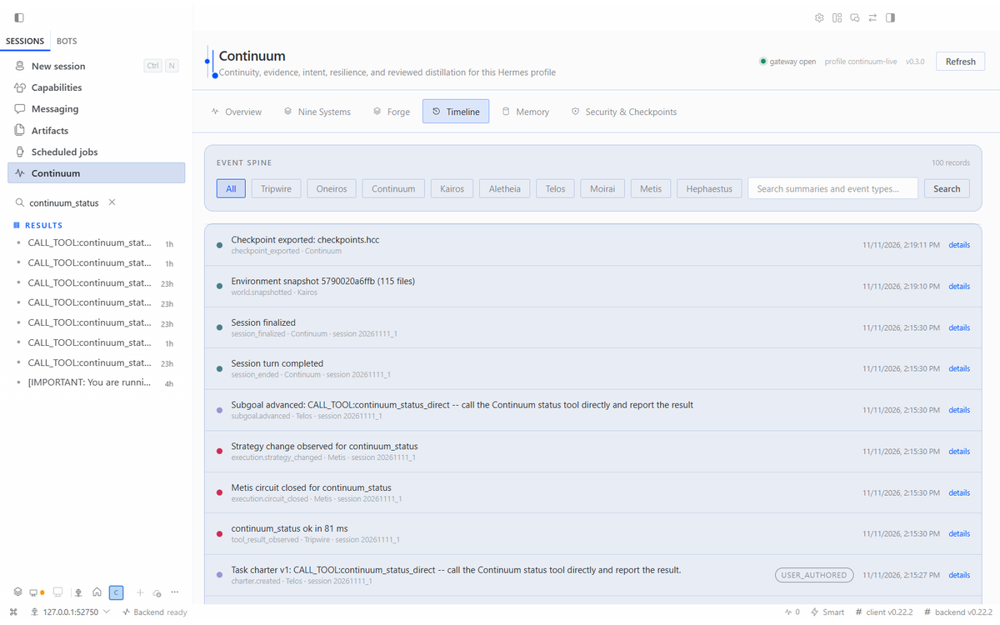
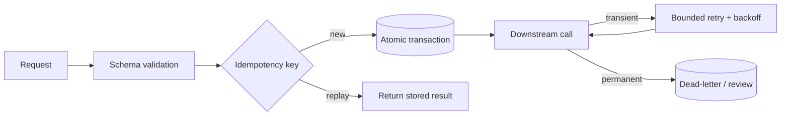

<strong>Backend engineer focused on reliable APIs, AI runtimes, and developer automation.</strong> 
<em>Fresher (BCA, 2026) · open to entry-level backend, full-stack, and applied AI systems roles.</em> 
Mangalore, India  

&nbsp;

&nbsp;

---

## Flagship Systems

<table>
<tr>
<td width="50%" valign="top">

<h3><a href="https://github.com/mohamad-shafeez/CrewMesh">CrewMesh</a></h3>

<strong>Race-proof team formation.</strong> Row locks, database constraints, and idempotency keys ensure exactly one person gets the last seat when fifty requests land at the same instant.

<code>TypeScript</code> · <code>Fastify</code> · <code>PostgreSQL</code> · <code>Server-Sent Events</code>

  

<!-- CI badge: replace WORKFLOW_FILE.yml with your workflow's file name, then uncomment

-->
</td>
<td width="50%" valign="top">

<h3><a href="https://github.com/mohamad-shafeez/api-pipeline-fixer">Resilient Integration Pipeline</a></h3>

<strong>Webhook ingestion that survives failure.</strong> Schema validation, canonical hashing, atomic idempotency, classified retries with backoff, and a transactional dead-letter queue. The downstream destination is a disclosed simulator.

<code>Python</code> · <code>FastAPI</code> · <code>SQLite</code> · <code>pytest</code>

 

</td>
</tr>
<tr>
<td width="50%" valign="top">

<h3><a href="https://github.com/mohamad-shafeez/ai-devops-assistant">AI DevOps Assistant</a></h3>

<strong>A reviewable DevOps starter generator.</strong> One LLM pass drafts 11 artifacts — Dockerfile, Compose, CI/CD, Kubernetes, Helm, Terraform, security and code reviews, environment example, deployment report, and architecture notes. Output is explicitly starter material, not deployment approval.

<code>Java 17</code> · <code>Spring Boot</code> · <code>Next.js</code> · <code>PostgreSQL</code>

 

<!-- Demo badge: add your video URL, then uncomment

-->
</td>
<td width="50%" valign="top">

<h3><a href="https://github.com/mohamad-shafeez/hermes-continuum">Hermes Continuum</a></h3>

<strong>A continuity layer for the Hermes Agent.</strong> Nine cooperating systems on one append-only event spine: reviewed memory, provenance, encrypted checkpoints, goal integrity, side-effect previews, retry circuits, and trace distillation.

<code>Python</code> · <code>SQLite</code> · <code>Hermes Agent</code> · <code>Desktop Console</code>

  

</td>
</tr>
</table>

Every screenshot above is from a running build, not a mockup. Test counts are from local runs on the current branches.

---

## Open Source

- **[NousResearch/hermes-agent#153650](https://github.com/NousResearch/hermes-agent/pull/153650)** — merged upstream. Added the plugin-catalog entry for `hermes-continuum` v0.3.0 to the Hermes Agent plugin registry.
- **Hermes Continuum** is MIT-licensed and tested against Hermes Agent `v0.22.2`. The plugin exposes 12 tools, 11 hooks, and 42 Console/API routes on a 25-table schema.

---

## How I Build

I optimize for the failure path first: validate at the edge, make state changes atomic, bound every retry, and keep a durable record when recovery is not possible.

That pattern shows up across the work above: PostgreSQL row locks and constraints in CrewMesh, transactional idempotency and a dead-letter table in the pipeline, server-derived auth in Auction House, and deterministic policy plus explicit approval gates in Hermes Continuum.

---

## Additional Projects

- **Cipher OS** — a Windows-first local AI runtime with supervised worker processes, three-tier memory, and 176 persona prompts across 13 domains. Six contract tests cover the core memory, watchdog, skill-loading, and configuration paths. [Repository](https://github.com/mohamad-shafeez/Cipher-AI)
- **SafeNav** — a health-aware travel-safety PWA with TomTom routing, live weather, and an owner-scoped Fernet-encrypted document vault. Three security tests cover encryption and owner isolation. [Repository](https://github.com/mohamad-shafeez/SafeNav)
- **Auction House** — a real-time MERN auction and token-draw platform with server-verified Firebase-to-JWT authentication, authenticated Socket.io, and atomic bid/token updates. Four server tests cover the auth and CORS boundaries. [Repository](https://github.com/mohamad-shafeez/Auction-House) · MIT

---

## Toolbox

| | |
| :--- | :--- |
| **Languages** | Java · Python · TypeScript · JavaScript · SQL |
| **Backend** | Spring Boot · FastAPI · Flask · Node.js · Fastify · REST APIs · Socket.io · Server-Sent Events |
| **Data** | PostgreSQL · MongoDB · MySQL · SQLite |
| **AI & Systems** | Gemini · Groq · Ollama · Faster-Whisper · ChromaDB · multiprocessing · process supervision |
| **Infrastructure** | Docker · GitHub Actions · Flyway · Maven · Git · Linux · Windows |
| **Frontend** | React · Next.js · Tailwind CSS |

---

### Open to entry-level backend, full-stack, and applied AI systems roles.

Mangalore, India

<a href="mailto:shafeezchappi18@gmail.com">Email</a> ·
<a href="https://linkedin.com/in/mohamad-shafeez">LinkedIn</a> ·
<a href="https://github.com/mohamad-shafeez">GitHub</a>

